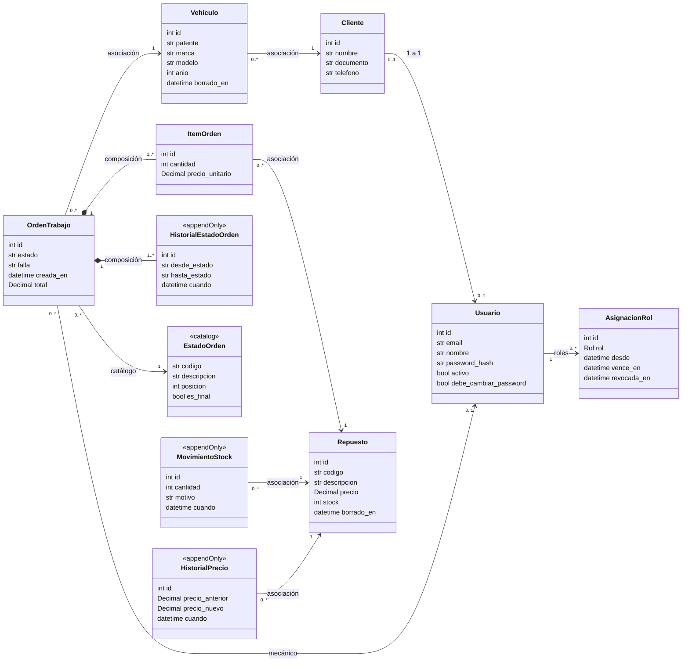
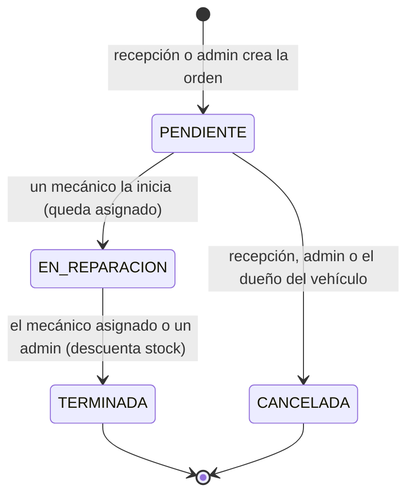

# Modelo de dominio

Los nombres de tablas y columnas son **obligatorios**: los casos de prueba y la corrección los
usan. Se pueden agregar columnas, pero no quitar ni renombrar las indicadas.

## Diagrama (Figura 1 de la consigna)

`IntentoAcceso` y `EventoSeguridad` no aparecen en el diagrama: no se relacionan con ninguna
otra tabla.

## Tablas

| Tabla | Columnas | Restricciones |
|---|---|---|
| `usuario` | id, email, nombre, password_hash, activo, debe_cambiar_password, password_cambiada_en (con zona, nulo) | `email` UNIQUE |
| `asignacion_rol` | id, usuario_id, rol, desde, vence_en (nulo), revocada_en (nulo), otorgada_por (nulo) | CHECK rol ∈ {ADMIN, RECEPCION, MECANICO, CLIENTE}; **único parcial** (usuario_id, rol) WHERE revocada_en IS NULL |
| `intento_acceso` | id, cuando, email, ip, exito | Índice (email, ip, cuando) |
| `evento_seguridad` | id, cuando, actor (texto), accion | — |
| `cliente` | id, usuario_id (nulo), nombre, documento, telefono | `usuario_id` UNIQUE; `documento` UNIQUE |
| `vehiculo` | id, cliente_id, patente, marca, modelo, anio, borrado_en (nulo) | **Único parcial** (patente) WHERE borrado_en IS NULL; CHECK anio BETWEEN 1950 AND 2100 |
| `repuesto` | id, codigo, descripcion, precio NUMERIC(10,2), stock, borrado_en (nulo) | **Único parcial** (codigo) WHERE borrado_en IS NULL; CHECK precio > 0; CHECK stock ≥ 0 |
| `estado_orden` | codigo (PK), descripcion, posicion, es_final | Catálogo; `posicion` UNIQUE |
| `orden_trabajo` | id, vehiculo_id, mecanico_id (nulo), estado, falla, creada_en, total NUMERIC(12,2) | `estado` FK a `estado_orden.codigo`; CHECK total ≥ 0 |
| `item_orden` | id, orden_id, repuesto_id, cantidad, precio_unitario NUMERIC(10,2) | CHECK cantidad > 0; CHECK precio_unitario > 0; UNIQUE (orden_id, repuesto_id) |
| `historial_estado_orden` | id, orden_id, desde_estado (nulo), hasta_estado, usuario_id, cuando | desde/hasta FK a `estado_orden.codigo`; **sólo agregado** |
| `movimiento_stock` | id, repuesto_id, orden_id (nulo), usuario_id, cantidad, motivo, cuando | CHECK cantidad <> 0; **sólo agregado** |
| `historial_precio_repuesto` | id, repuesto_id, usuario_id, precio_anterior, precio_nuevo, cuando | CHECK precio_nuevo > 0; CHECK precio_nuevo <> precio_anterior; **sólo agregado** |

Todas las fechas son `timestamptz`. El dinero es `NUMERIC` (en Python, `Decimal`; nunca `float`).
Cada clave foránea lleva un índice.

## Módulos y dónde vive cada modelo

| Módulo | Modelos |
|---|---|
| `health` | (sólo `router.py`) |
| `usuarios` | Usuario, AsignacionRol, IntentoAcceso, EventoSeguridad |
| `clientes` | Cliente, Vehiculo |
| `repuestos` | Repuesto, MovimientoStock, HistorialPrecio |
| `ordenes` | EstadoOrden, OrdenTrabajo, ItemOrden, HistorialEstadoOrden |

## Ciclo de vida de una orden

TERMINADA y CANCELADA son finales (`es_final = true`): definen qué es una orden **abierta**
(RN-16).

## Glosario

| Término | Significado |
|---|---|
| Vigente (rol) | Asignación no revocada, ya empezada y sin vencer |
| Abierta (asignación) | Asignación con `revocada_en IS NULL`, vigente o vencida |
| Vigente (vehículo, repuesto) | Fila con `borrado_en IS NULL` |
| Dar de baja | Borrado lógico: escribir `borrado_en`; la fila se conserva |
| Orden abierta | En un estado que el catálogo no marca como final |
| Sólo agregado | Tabla que acepta INSERT y rechaza UPDATE y DELETE (disparador) |
| Catálogo | Tabla de referencia que carga `seed.py` y que la API sólo lee |
| Lo propio | Recursos del usuario autenticado: sus vehículos y sus órdenes |
| Hash ficticio | Hash bcrypt calculado al arrancar para verificar cuando el correo no existe |
| Punto único de stock | El único código que escribe `repuesto.stock`, siempre con su movimiento |
