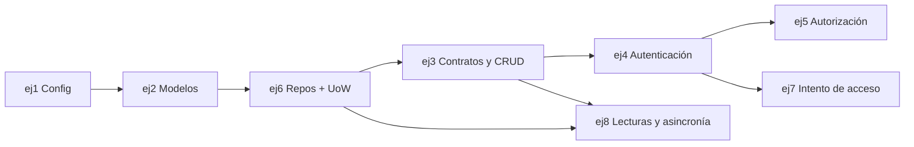

# Roadmap

Plan de trabajo del TP por *changes* de OpenSpec. Cada fila es un ejercicio de la consigna con
su *change* en [`changes/`](changes). Se actualiza al cerrar cada uno.

**Estado documental actualizado:** ejercicios 1 a 6 implementados (más el disparador y `AccesoUnitOfWork` del ejercicio 7); los ejercicios 4, 5 y 6 están verificados y archivados. Las verificaciones ejecutadas y sus límites están en `docs/validacion-ej5-ej6.md`.

## Estado

| Orden | Change | Ejercicio | Puntos | Depende de | Estado |
|---|---|---|---|---|---|
| 1 | [`ej1-proyecto-config`](changes/ej1-proyecto-config) | Proyecto, configuración y ciclo de vida | 8 | — | ✅ Implementado · falta verificar en la máquina |
| 2 | [`ej2-modelos-migraciones`](changes/ej2-modelos-migraciones) | Modelos, relaciones y migraciones | 14 | ej1 | ✅ Implementado · falta `alembic check` y ciclo de migraciones |
| 3 | [`ej6-repositorios-uow`](changes/archive/2026-10-30-ej6-repositorios-uow) | Repositorios y Unit of Work | 20 | ej2 | ✅ Implementado y archivado; atomicidad HTTP + PostgreSQL |
| 4 | [`ej3-contratos-crud`](changes/ej3-contratos-crud) | Contratos y CRUD | 10 | ej2, ej6 | ✅ Implementado y verificado |
| 5 | [`ej4-autenticacion`](changes/archive/2026-10-29-ej4-autenticacion) | Autenticación | 16 | ej3, ej6 | ✅ Implementado, archivado y verificado |
| 6 | [`ej5-autorizacion`](changes/archive/2026-10-30-ej5-autorizacion) | Autorización | 14 | ej4 | ✅ Implementado y archivado; pruebas HTTP + PostgreSQL |
| 7 | [`ej7-integridad`](changes/ej7-integridad) | Integridad: sólo agregado e intento de acceso | 10 | ej2, ej4 | ✅ Disparador y `AccesoUnitOfWork` hechos · falta captura de `psql` |
| 8 | [`ej8-lecturas-asincronia`](changes/ej8-lecturas-asincronia) | Lecturas sin N+1 y asincronía | 8 | ej3, ej6 | ⏳ Change listo, sin implementar |

## Por qué este orden

- **ej6 antes que ej3:** los servicios del CRUD abren un Unit of Work y usan repositorios. Se
  hace primero el núcleo (`BaseRepository`, `SoftDeleteRepository`, `UnitOfWork`, punto único de
  stock) y después cada módulo los usa. Las tareas 3.1 a 3.3 de ej6 (RN-02, RN-13, RN-20) se
  cierran cuando existan los servicios que las usan: RN-13 y RN-20 con ej3, RN-02 con ej4.
- **ej4 antes que ej5:** sin login no hay usuario actual del que consultar roles.
- **ej7 después de ej4:** el intento de acceso se anota desde el login.
- **ej8 al final:** optimiza lecturas que ya existen.

Los endpoints de negocio ya exigen sesión y permisos de E5. Los casos `.http` usan los usuarios del seed.

## Hitos

| Hito | Changes | Qué se puede mostrar |
|---|---|---|
| **H1 · Base de datos** ✅ | ej1, ej2 | La app levanta, `/health`, esquema con Alembic, `seed.py`, C-14 |
| **H2 · Núcleo de datos** | ej6 | Repositorios, UoW, stock en un único punto |
| **H3 · API sin seguridad** ✅ | ej3 | CRUD completo, paginación, 409/422 propios; C-16, C-17, C-19 |
| **H4 · Acceso** | ej4, ej5, ej7 | Login, cookie, roles; C-01 a C-09, C-13 |
| **H5 · Entrega** | ej8 + evidencias | C-10 a C-15, C-18; capturas de C-14 y C-15; README final |

## Casos de prueba por hito

| Hito | Casos |
|---|---|
| H1 | C-14 |
| H3 | C-16, C-17, C-19 (sin sesión mientras no esté ej4) |
| H4 | C-01 a C-09, C-13 |
| H5 | C-10, C-11, C-12, C-15, C-18 |

## Pendientes fuera de los changes

- [ ] Correr en la máquina: `alembic upgrade head` → `downgrade base` → `upgrade head` y `alembic check`.
- [ ] Captura de `psql` para C-14 (`docs/evidencias/`).
- [ ] Captura de la consola para C-15 (`docs/evidencias/`).
- [ ] Resolver las preguntas abiertas de [`discovery/decisiones.md`](discovery/decisiones.md).
- [ ] Al cerrar cada change: `openspec archive <change>`.
